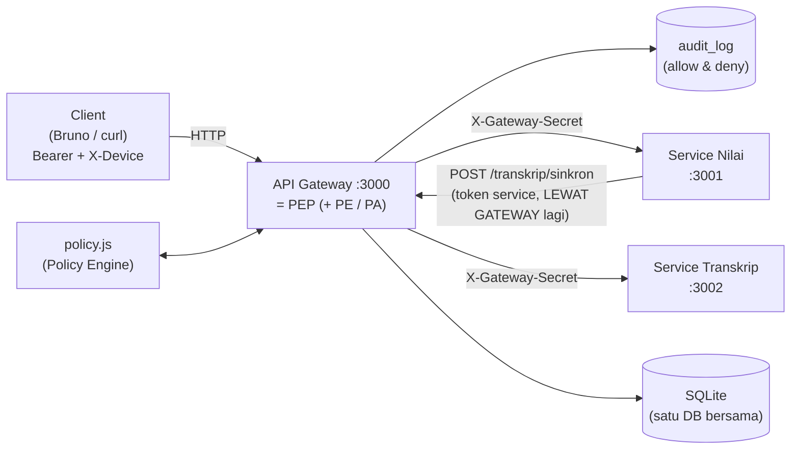

# Sistem Nilai Zero Trust - Praktikum Zero Trust Security


Tugas Praktikum Individu — **Keamanan Informasi (KP70065004)**.

Implementasi *zero trust* pada level aplikasi: satu **API Gateway (PEP)** di depan
dua **service (Resource)**, dengan **Policy Engine**, verifikasi device, jam akses,
audit log, dan token terpisah untuk service.

> *Never trust, always verify.* Setiap request — termasuk panggilan antar-service —
> diperiksa ulang.

---

## Daftar isi

1. [Clone & setup](#1-clone--setup)
2. [Arsitektur](#2-arsitektur)
3. [Menjalankan](#3-menjalankan)
4. [Akun & device](#4-akun--device-seed)
5. [Endpoint](#5-endpoint)
6. [Alur penting](#6-alur-penting)
7. [Pengujian](#7-pengujian)
8. [Bruno](#8-bruno)
9. [Audit log](#9-audit-log)
10. [Struktur folder](#10-struktur-folder)
11. [Kontrol keamanan](#11-kontrol-keamanan)
12. [Troubleshooting](#12-troubleshooting)
13. [Docker](#13-docker-opsional)

---

## 1. Clone & setup

```bash
git clone https://github.com/Raka-coder/praktikum-zt-system.git
cd praktikum-zts
npm install
```

Salin konfigurasi (file `.env` sudah di-gitignore, jangan commit):

```bash
cp .env.example .env
```

Isi secret dengan string acak:

```bash
openssl rand -hex 32   # untuk JWT_SECRET dan GATEWAY_SECRET
openssl rand -hex 24   # untuk SERVICE_CLIENT_SECRET
```

Inisialisasi database & data demo (idempoten):

```bash
npm run seed
```

Jalankan sistem:

```bash
npm start
```

Cek sistem hidup:

```bash
curl http://127.0.0.1:3000/health
# {"status":"ok","service":"gateway"}
```

> Catatan port: `.env` bawaan repo memakai **PORT_GATEWAY=3100** karena port 3000
> di komputer pengembang dipakai layanan lain (Docker/Dokploy). Di komputer yang
> port 3000-nya bebas, ubah `PORT_GATEWAY=3000` dan `GATEWAY_URL` ikut disamakan.
> Service tetap di 3001/3002 sesuai soal.

---

## 2. Arsitektur

[](https://gitdiagram.com/raka-coder/praktikum-zt-system?utm_source=readme&utm_medium=picture)



| Komponen | Port | Peran NIST SP 800-207 | Kode |
|---|---|---|---|
| API Gateway | 3000 (`3100` di dev ini) | PEP | `gateway/server.js` |
| Policy Engine / PA | — | PE / PA | `gateway/policy.js`, `gateway/routes/auth.js` |
| Service Nilai | 3001 | Resource | `services/nilai/` |
| Service Transkrip | 3002 | Resource | `services/transkrip/` |
| Database | — | Resource | `db/schema.sql` (SQLite) |
| Audit Log | — | Data source | tabel `audit_log` |

---

## 3. Menjalankan

```bash
npm run seed             # isi data awal (idempoten: hapus lalu isi ulang)
npm start                # gateway + service nilai + service transkrip sekaligus
```

Keluaran:

```
[start-all] gateway :3000, nilai :3001, transkrip :3002
[gateway] PEP berjalan di http://127.0.0.1:3000
[nilai] berjalan di http://127.0.0.1:3001
[transkrip] berjalan di http://127.0.0.1:3002
```

Cek cepat:

```bash
curl http://127.0.0.1:3000/health
```

Menjalankan terpisah (tiga terminal):

```bash
npm run gateway
npm run nilai
npm run transkrip
```

---

## 4. Akun & device (seed)

| Username / NIM | Role | Password | Device ID | Keterangan |
|---|---|---|---|---|
| `admin01` | admin | `Admin123!` | `DEV-ADMIN-01` | Melihat semua transkrip |
| `dosen01` | dosen | `Dosen123!` | `DEV-DOSEN-01` | Mengampu **IF-101-A** |
| `dosen02` | dosen | `Dosen123!` | `DEV-DOSEN-02` | Mengampu **IF-102-B** |
| `2024001` | mahasiswa | `Mhs123!` | `DEV-MHS-01` | Terdaftar IF-101-A |
| `2024002` | mahasiswa | `Mhs123!` | `DEV-MHS-02` | Terdaftar IF-101-A |
| `2024003` | mahasiswa | `Mhs123!` | `DEV-MHS-03` | Terdaftar IF-102-B |

Service client: `nilai-service` / lihat `SERVICE_CLIENT_SECRET` di `.env`
(hex acak, di-hash bcrypt saat `npm run seed`).

Kelas: `IF-101-A` (Keamanan Informasi, dosen01), `IF-102-B` (Pemrograman Web, dosen02).

Nilai awal: 2024001 = 82/AB, 2024002 = 76/B (IF-101-A), 2024003 = 88/A (IF-102-B).
Password disimpan sebagai bcrypt hash; secret service juga di-hash.

---

## 5. Endpoint

| Method | Endpoint | Role | Kondisi tambahan |
|---|---|---|---|
| POST | `/auth/login` | publik | password valid + `X-Device-ID` terdaftar |
| POST | `/auth/refresh` | publik | refresh token ada, belum dicabut, belum kedaluwarsa |
| POST | `/auth/logout` | publik | mencabut refresh token (idempoten) |
| POST | `/auth/service` | publik | `client_id` + `client_secret` valid → token 5 menit, role `service` |
| GET | `/nilai` | mahasiswa, dosen | difilter kepemilikan (NIM sendiri / kelas yang diampu) |
| PUT | `/nilai/:id` | dosen | kelas diampu, `status='open'`, jam 07.00–21.00 |
| POST | `/kelas/:id/finalisasi` | dosen | kelas diampu, `status='open'`, jam 07.00–21.00 |
| GET | `/transkrip/:nim` | mahasiswa, admin | mahasiswa hanya NIM sendiri |
| POST | `/transkrip/sinkron` | service | token user ditolak |
| lainnya | — | — | **default deny** |

`:id` kelas menerima id numerik **atau** kode (`IF-101-A`).
Semua endpoint selain `/auth/*` wajib `Authorization: Bearer <access>` dan
(untuk user) `X-Device-ID`. Setiap keputusan allow/deny ditulis ke `audit_log`.

---

## 6. Alur penting

### 6.1 Login

```bash
curl -s -X POST $GW/auth/login \
  -H 'Content-Type: application/json' \
  -H 'X-Device-ID: DEV-DOSEN-01' \
  -d '{"username":"dosen01","password":"Dosen123!"}'
```

Access token 10 menit (`sub`, `role`, `nim`/`username`), refresh token 1 hari
(disimpan sebagai SHA-256).

### 6.2 Dosen mengubah nilai → finalisasi → transkrip

```bash
# token
TOKEN=$(curl -s -X POST $GW/auth/login -H 'Content-Type: application/json' \
  -H 'X-Device-ID: DEV-DOSEN-01' \
  -d '{"username":"dosen01","password":"Dosen123!"}' | node -pe 'JSON.parse(require("fs").readFileSync(0)).access_token')

# ubah nilai (id 1 = nilai 2024001 di IF-101-A)
curl -s -X PUT $GW/nilai/1 -H "Authorization: Bearer $TOKEN" \
  -H 'X-Device-ID: DEV-DOSEN-01' -H 'Content-Type: application/json' -d '{"angka":95}'

# finalisasi (Service Nilai lalu ambil token service & panggil /transkrip/sinkron LEWAT gateway)
curl -s -X POST $GW/kelas/IF-101-A/finalisasi -H "Authorization: Bearer $TOKEN" \
  -H 'X-Device-ID: DEV-DOSEN-01'

# cek transkrip sebagai admin
ADMIN=$(curl -s -X POST $GW/auth/login -H 'Content-Type: application/json' \
  -H 'X-Device-ID: DEV-ADMIN-01' \
  -d '{"username":"admin01","password":"Admin123!"}' | node -pe 'JSON.parse(require("fs").readFileSync(0)).access_token')
curl -s $GW/transkrip/2024001 -H "Authorization: Bearer $ADMIN" -H 'X-Device-ID: DEV-ADMIN-01'
```

### 6.3 Membuktikan service tidak bisa diakses langsung

```bash
curl -i http://127.0.0.1:3001/nilai
# 403 {"error":"akses langsung ke service ditolak"}

# walau membawa secret yang benar, token tetap wajib diverifikasi:
curl -i http://127.0.0.1:3001/nilai -H 'X-Gateway-Secret: <GATEWAY_SECRET>'
# 401 access token tidak ditemukan
```

### 6.4 Demo jam akses

Ubah `.env` sementara:

```env
JAM_MULAI=0        # jam boleh di set bebas
JAM_SELESAI=0      # rentang kosong → semua perubahan ditolak
```

Restart `npm start`, lalu `PUT /nilai/1` →
`403 perubahan nilai hanya diizinkan pukul 00.00–00.00 (di luar jam akses)`.
Kembalikan jam ke `7` dan `21` setelah demo.

---

## 7. Pengujian

### Otomatis (satu perintah)

```bash
npm test
```

`tests/e2e.sh` menyalakan sistem dengan DB terpisah (`db/test-e2e.db`), lalu
menguji **47 assertion**:

- login benar/salah, device salah, token invalid/kedaluwarsa
- token service, kredensial service salah
- kepemilikan nilai & transkrip, admin vs dosen vs mahasiswa
- ubah nilai, validasi angka, finalisasi, ubah setelah final, finalisasi ulang
- sinkron transkrip otomatis & manual, token user ditolak
- refresh, logout, refresh token lama ditolak
- akses langsung ke port service (tanpa secret, dengan secret tanpa token)
- jam akses di luar rentang (gateway kedua dengan `JAM_MULAI=0 JAM_SELESAI=0`)
- audit log: total baris, deny jam akses, keputusan token service

Contoh keluaran: `== Hasil: 47/47 lulus ==`.

### Postman

Import `tests/postman_collection.json`, jalankan folder **00 - Auth** lebih dulu
(menyimpan token ke collection variable), lalu folder lain.
`baseUrl` default `http://127.0.0.1:3000`.

### Manual

| No | Aksi | Harapan |
|---|---|---|
| 1 | 2024001 `GET /nilai` + `DEV-MHS-01` | 200, hanya nilai 2024001 |
| 2 | 2024001 `GET /nilai` + `DEV-MHS-02` | 403 device tidak terdaftar |
| 3 | 2024001 `GET /transkrip/2024002` | 403 NIM sendiri |
| 4 | 2024001 `GET /transkrip/2024001` | 200 |
| 5 | dosen01 `PUT /nilai/3` (milik IF-102-B) | 403 bukan diampu |
| 6 | dosen01 `PUT /nilai/1` (sebelum final) | 200 |
| 7 | dosen01 `POST /kelas/IF-101-A/finalisasi` | 200, status final + transkrip tersinkron |
| 8 | dosen01 `PUT /nilai/1` setelah final | 403 sudah difinalisasi |
| 9 | Perubahan saat `.env` di luar jam | 403 di luar jam akses |
| 10 | admin01 `GET /transkrip/2024003` | 200 |
| 11 | dosen01 `POST /transkrip/sinkron` | 403 hanya untuk service |
| 12 | `curl :3001/nilai` tanpa secret | 403 akses langsung ditolak |
| 13 | `POST /auth/refresh` setelah logout | 401 sudah dicabut |
| 14 | Token kedaluwarsa | 401 kedaluwarsa |

---

## 8. Bruno

Koleksi Bruno (sumber utama pengujian manual) ada di **`tests/collections-bruno/`** (file `.bru` native).

### 8.1 Buka koleksi

1. Install Bruno (<https://www.usebruno.com/download>).
2. **Open Collection** → pilih folder `tests/collections-bruno`.
3. Pilih environment **Local** (kanan atas).
4. Jalankan folder **01-Auth & Device Verification** dulu (menyimpan
   `dosenToken`/`mhsToken`), lalu **07-Admin Access** untuk `adminToken`,
   baru folder lain.

### 8.2 Alur yang diuji (prinsip zero trust)

| Folder | Request | Harapan |
|---|---|---|
| 00-Setup & Environment | Health Cek Server | 200 |
| 01-Auth & Device Verification | Login Dosen | 200, `dosenToken` tersimpan |
| | Login Mahasiswa | 200, `mhsToken` tersimpan |
| 02-Least Privilege: Dosen | GET Nilai Kelas Sendiri (Filtered) | 200 |
| | Ubah Nilai Kelas Sendiri (Allow) | 200 |
| | Ubah Nilai Kelas Orang Lain (Deny) | 403 |
| 03-Context Verification | Ubah Nilai Di Luar Jam (Deny) | 403 (set `.env` 0/0 dulu) |
| 04-Inter-Service Communication | Finalisasi Kelas (Allow) | 200, `sinkron.ok=true` |
| 05-Least Privilege: Mahasiswa | Lihat Transkrip Sendiri (Allow) | 200 |
| | Lihat Transkrip Teman (Deny) | 403 |
| 06-Service Security & Audit | Akses Langsung ke Port Service (Deny) | 403 |
| | Akses Langsung dengan Secret Tapi Tanpa Token (Deny) | 401/403 |
| 07-Admin Access | Login Admin | 200, `adminToken` tersimpan |
| | Admin Melihat Transkrip Mahasiswa (Allow) | 200 |

> Folder 04 memfinalisasi IF-101-A. Jalankan dari kondisi bersih
> (`npm run seed`) agar tidak 403 `kelas sudah difinalisasi`.

### 8.3 Catatan koleksi

- `tests/collections-bruno/` = sumber utama, file `.bru` native yang selalu diperbarui.
- `tests/exports-postman-yml/` = snapshot ekspor terakhir (YML) untuk dokumentasi/migrasi; **jangan** dipakai untuk testing aktif.
- Buka folder `tests/collections-bruno/` langsung dari aplikasi Bruno, tanpa import/export.

### 8.4 Variabel environment

| Variable | Sumber |
|---|---|
| `dosenToken` | diset oleh Login Dosen |
| `mhsToken` | diset oleh Login Mahasiswa |
| `adminToken` | diset oleh Login Admin (folder 07) |
| `GATEWAY_SECRET` | dibaca dari `process.env` (Bruno) |

---

## 9. Audit log

```bash
npm run audit          # 15 baris terakhir
npm run audit -- 50    # 50 baris
npm run audit -- deny  # hanya penolakan
```

Setiap keputusan allow/deny tercatat: subjek, endpoint, device, alasan, IP.

---

## 10. Struktur folder

```
├── db/
│   ├── database.js
│   ├── schema.sql
│   └── seed.js
├── gateway/
│   ├── middleware/
│   │   ├── audit.js
│   │   ├── authenticate.js
│   │   ├── deviceCheck.js
│   │   └── timeWindow.js
│   ├── routes/
│   │   └── auth.js
│   ├── policy.js
│   └── server.js
├── lib/
│   ├── config.js
│   ├── kelas.js
│   ├── timeWindow.js
│   └── tokens.js
├── scripts/
│   ├── audit.js
│   └── start-all.js
├── services/
│   ├── nilai/
│   │   ├── lib/
│   │   │   └── gatewayClient.js
│   │   ├── middleware/
│   │   │   ├── gatewaySecret.js
│   │   │   └── verifyToken.js
│   │   ├── routes/
│   │   │   └── nilai.js
│   │   └── server.js
│   └── transkrip/
│       ├── middleware/
│       │   ├── gatewaySecret.js
│       │   └── verifyToken.js
│       ├── routes/
│       │   └── transkrip.js
│       └── server.js
├── tests/
│   ├── collections-bruno/
│   │   ├── 00-Setup & Environment/
│   │   │   └── Health Cek Server.bru
│   │   ├── 01-Auth & Device Verification (Prinsip- Never Trust)/
│   │   │   ├── Login Dosen.bru
│   │   │   └── Login Mahasiswa.bru
│   │   ├── 02-Least Privilege- Dosen (Prinsip- Least Privilege)/
│   │   │   ├── GET Nilai Kelas Sendiri (Filtered).bru
│   │   │   ├── Ubah Nilai Kelas Orang Lain (Deny).bru
│   │   │   └── Ubah Nilai Kelas Sendiri (Allow).bru
│   │   ├── 03-Context Verification (Prinsip- Context Awareness)/
│   │   │   └── Ubah Nilai Di Luar Jam (Deny).bru
│   │   ├── 04-Inter-Service Communication (Prinsip- Assume Breach)/
│   │   │   └── Finalisasi Kelas (Allow).bru
│   │   ├── 05-Least Privilege- Mahasiswa (Prinsip- Least Privilege)/
│   │   │   ├── Lihat Transkrip Sendiri (Allow).bru
│   │   │   └── Lihat Transkrip Teman (Deny).bru
│   │   ├── 06-Service Security & Audit (Prinsip- Assume Breach + Accountability)/
│   │   │   ├── Akses Langsung dengan Secret Tapi Tanpa Token (Deny).bru
│   │   │   └── Akses Langsung ke Port Service (Deny).bru
│   │   ├── 07-Admin Access/
│   │   │   ├── Admin Melihat Transkrip Mahasiswa (Allow).bru
│   │   │   └── Login Admin.bru
│   │   ├── environments/
│   │   │   └── Local.bru
│   │   └── bruno.json
│   ├── exports-postman-yml/
│   │   ├── 00-Setup & Environment/
│   │   │   ├── folder.yml
│   │   │   └── Health Cek Server.yml
│   │   ├── 01-Auth & Device Verification (Prinsip- Never Trust)/
│   │   │   ├── folder.yml
│   │   │   ├── Login Dosen.yml
│   │   │   └── Login Mahasiswa.yml
│   │   ├── 02-Least Privilege- Dosen (Prinsip- Least Privilege)/
│   │   │   ├── folder.yml
│   │   │   ├── GET Nilai Kelas Sendiri (Filtered).yml
│   │   │   ├── Ubah Nilai Kelas Orang Lain (Deny).yml
│   │   │   └── Ubah Nilai Kelas Sendiri (Allow).yml
│   │   ├── 03-Context Verification (Prinsip- Context Awareness)/
│   │   │   ├── folder.yml
│   │   │   └── Ubah Nilai Di Luar Jam (Deny).yml
│   │   ├── 04-Inter-Service Communication (Prinsip- Assume Breach)/
│   │   │   ├── Finalisasi Kelas (Allow).yml
│   │   │   └── folder.yml
│   │   ├── 05-Least Privilege- Mahasiswa (Prinsip- Least Privilege)/
│   │   │   ├── folder.yml
│   │   │   ├── Lihat Transkrip Sendiri (Allow).yml
│   │   │   └── Lihat Transkrip Teman (Deny).yml
│   │   ├── 06-Service Security & Audit (Prinsip- Assume Breach + Accountability)/
│   │   │   ├── Akses Langsung dengan Secret Tapi Tanpa Token (Deny).yml
│   │   │   ├── Akses Langsung ke Port Service (Deny).yml
│   │   │   └── folder.yml
│   │   ├── 07-Admin Access/
│   │   │   ├── Admin Melihat Transkrip Mahasiswa (Allow).yml
│   │   │   ├── folder.yml
│   │   │   └── Login Admin.yml
│   │   ├── environments/
│   │   │   └── environment.yml
│   │   ├── .gitignore
│   │   └── opencollection.yml
│   ├── e2e.sh
│   └── postman_collection.json
├── .env.example
├── .gitignore
├── docker-compose.yml
├── Dockerfile
├── package-lock.json
├── package.json
├── README.md
└── TUTORIAL-API.md

```

---

## 11. Kontrol keamanan

| Kontrol | Implementasi |
|---|---|
| Never trust | Gateway memeriksa setiap request; service **memverifikasi ulang** JWT (`services/*/middleware/verifyToken.js`) |
| Assume breach | Service menolak tanpa `X-Gateway-Secret`; service bind ke `127.0.0.1` |
| Least privilege | Policy matrix per endpoint + token service hanya untuk `POST /transkrip/sinkron` |
| Kepemilikan data | `policy.js` membaca DB (`kelas.dosen_id`, `users.nim`, `kelas.status`) — bukan dari token/body |
| Token | Access 10 menit, service 5 menit, refresh 1 hari dengan hash SHA-256 + `revoked_at` |
| Kredensial | bcrypt (cost 10) untuk password dan client secret |
| Konteks | `X-Device-ID` dicek ke tabel `devices`; jam akses 07.00–21.00 (TZ Asia/Jakarta, dari `.env`) |
| Audit | Satu baris per keputusan (`allow`/`deny`) berisi subjek, endpoint, device, alasan, IP |
| Anti-spoof | `X-Gateway-Secret` dari client selalu **ditimpa** gateway saat proxy |

Catatan: JWT memakai HS256 dengan secret bersama agar sederhana untuk satu komputer.
Untuk produksi: RS256 (public key di service), rotasi refresh token, rate limiting
login, dan TLS di depan gateway.

---

## 12. Troubleshooting

| Gejala | Penyebab / solusi |
|---|---|
| `curl $GW` mengembalikan HTML/404 aneh | Port bentrok (mis. Docker memakai 3000). Set `PORT_GATEWAY` + `GATEWAY_URL` ke port bebas |
| `EADDRINUSE` | Ada proses lain di port tersebut: `ss -ltnp \| grep :3000` |
| `401 access token kedaluwarsa` | Access token hanya 10 menit — login/refresh ulang |
| Data ingin direset | `npm run seed` |
| Sinkron transkrip gagal | Cek log `[nilai]`/`[transkrip]`; pastikan gateway hidup dan `SERVICE_CLIENT_SECRET` sama dengan seed |
| `403 akses langsung ke service ditolak` | Memang benar: akses harus lewat gateway |
| Bruno 401 semua request | Environment belum dipilih → pilih **Local** |
| Bruno token kosong | Jalankan folder 01 lebih dulu |

---

## 13. Docker (opsional)

```bash
docker compose up --build -d
# gateway: http://127.0.0.1:3000 (ubah HOST_GATEWAY_PORT bila bentrok)
docker compose logs -f gateway
```

Satu container menjalankan gateway + dua service (sesuai "satu komputer"), DB di
volume `zts-db`.

---

## Referensi

Panduan uji manual lengkap (Postman/Bruno, skenario, run sheet rekaman):
[TUTORIAL-API.md](TUTORIAL-API.md).

